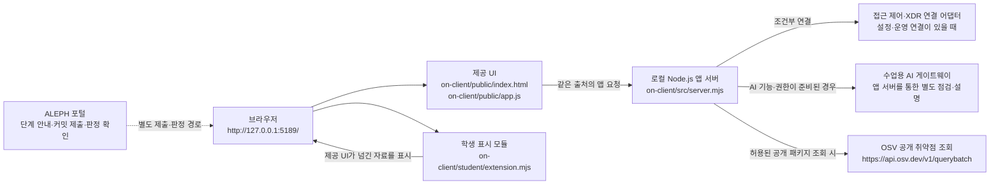

# 다아트 학생용 실행 설명서와 시스템 구성도

이 문서는 ALEPH 4차 방어전 21단계용 안내입니다. 과제에서 정한 이름은 **다아트**입니다. 다만 기존 시작 틀의 제품 이름·파일 이름·실행 중인 앱 제목을 자동으로 바꾸지는 않습니다. 현재 제공 `README.md`와 실행 스크립트는 **케셰브**라는 이름을 사용하며, 실행 확인 문구도 `케셰브가 켜졌습니다`로 출력합니다. 실행에 사용되는 기존 파일·폴더 이름은 그대로 둡니다.

## 1. 목적과 기능 범위

직원이 본인의 로그인·기기·세션 상태, 업무 앱 접근 판정, 본인에게 전달된 접속 기록과 저장된 XDR 경보를 확인하는 보안 Agent 프로젝트입니다. AI 설명이 제공되는 경우에도 참고 정보이며, 설명이나 제안만으로 보안 조치가 실행되는 것은 아닙니다.

| 범위 | 설명 |
|---|---|
| 학생 구현 경계 | 학생 화면 코드는 `student/extension.mjs`에 둡니다. 제공 UI가 `createStudentView`와 학생 표시 함수들을 불러오는 구조입니다. |
| 제공 UI·서버 | `public/app.js`, `public/index.html`, `src/`, 실행 도구는 시작 틀의 제공 코드입니다. 단계 안내에서 허용하지 않는 한 수정하지 않습니다. |
| 기본 연결 상태 | 기본 실행은 실제 회사 접근 제어 시스템에 연결되지 않은 상태입니다. `--demo`는 예제 자료를 보여 주는 모드이며 실제 연결·권한·성취를 뜻하지 않습니다. |
| 관측 범위 | 보안 기록은 본인 범위의 최근 기록이고, XDR 경보는 저장된 기록입니다. 화면에 표시된 범위를 전체 직원 로그나 실시간 전체 위협 탐지로 확대 해석하지 않습니다. |
| AI | AI 연결 점검과 사건 설명은 별도 동작입니다. 모델 목록·연결 점검 결과만으로 사건 설명이 실행됐다고 볼 수 없습니다. |
| 패키지 조회 | OSV는 알려진 공개 취약점 정보 조회입니다. 미조회·일부 실패·조회 결과 없음은 앱 전체가 안전하다는 보증이 아닙니다. |
| 보안 조치 | 조치 제안, 사용자 확인, 서버 접수, 실제 효과 관측은 서로 다른 상태입니다. ACK는 효과 확인이 아니며, 학생 코드에 조치 요청이나 인증 비밀을 추가하지 않습니다. |

## 2. 확인된 실행 환경과 프로젝트 구조

### 버전·지원 환경

| 항목 | 프로젝트에서 확인한 값 | 의미와 한계 |
|---|---|---|
| 앱 패키지 | `alekov-client-starter` `0.2.11` (`on-client/package.json`) | 파일의 프로젝트 버전이며 다아트라는 이름이나 실행 앱 제목을 바꾸지 않습니다. |
| Node.js | `package.json`의 `engines.node`는 `24.19.0` | `tools/start-alekov.ps1`은 Node.js 22~24를 허용하고, `v24.19.0`이 아니면 안내를 출력합니다. 두 기준이 다르므로 재현을 위해 **24.19.0 사용을 권장**합니다. 다른 허용 패치 버전의 호환성을 이 문서에서 시험하지 않았습니다. |
| 실제 설치 버전 | 확인하지 않음 | 이 문서를 작성할 때 PC의 `node --version`을 실행하지 않았습니다. |
| npm 의존성 | `package.json`에 외부 `dependencies` 항목 없음 | 앱 실행에 `npm install`이 필요하다고 문서화하지 않습니다. 설치·실행은 하지 않았습니다. |
| 잠금 파일 | 프로젝트 파일 검색에서 `package-lock.json`을 찾지 못함 | 현재 검색 결과 기준입니다. 패키지 취약점 단계의 설치 목록·정확한 설치 버전을 이 문서가 증명하지 않습니다. |
| PowerShell·브라우저 | 실제 버전과 화면 동작 미확인 | 제공 실행 도구는 Windows PowerShell 사용을 안내합니다. 브라우저 버전·다른 OS 지원 여부는 확인하지 않았습니다. |

### 실행에 필요한 실제 경로

프로젝트 폴더 안의 앱 폴더는 `on-client/`입니다. **PowerShell은 `on-client` 폴더에서** 열어야 합니다.

```text
on-client/
├── README.md
├── package.json
├── tools/
│   └── start-alekov.ps1
├── public/
│   ├── index.html
│   ├── app.js
│   └── vulnerabilities-view.mjs
├── student/
│   └── extension.mjs
├── src/
│   ├── server.mjs
│   ├── engine.mjs
│   ├── ai/
│   ├── connection/
│   └── vulnerabilities/
└── docs/
    ├── STUDENT_LAUNCH_GUIDE.md
    ├── CONNECTION_TROUBLESHOOT.md
    ├── IMPLEMENTATION_CONTRACT.md
    └── STUDENT_RUNBOOK.md
```

위 경로들은 프로젝트에서 확인한 파일·폴더입니다. 예시 구조에 보이지 않는 구성 파일을 새로 만들거나 옮길 필요는 없습니다.

## 3. 실행·종료·재실행

### 일반 실행

1. 파일 탐색기에서 프로젝트의 `on-client` 폴더를 엽니다.
2. 해당 폴더의 주소 표시줄에 `powershell`을 입력하고 Enter를 눌러 그 위치에서 PowerShell을 엽니다.
3. 먼저 `Get-Location`으로 현재 위치가 `on-client`인지 확인할 수 있습니다.
4. 아래 명령을 실행합니다.

```powershell
powershell -NoProfile -ExecutionPolicy Bypass -File .\tools\start-alekov.ps1
```

5. 제공 실행 도구가 다음 안내를 출력하면 브라우저에서 주소를 엽니다.

```text
케셰브가 켜졌습니다. 브라우저에서 http://127.0.0.1:5189/ 을 여세요.
서버가 응답한 것만 확인했습니다. AI 연결 상태는 화면에서 따로 확인해 주세요.
```

브라우저 주소는 `http://127.0.0.1:5189/`입니다. 실행 도구는 이 주소의 로컬 서버가 HTTP 200으로 응답하는지 확인합니다. 이는 **로컬 서버 응답 확인**이지, SDP·AI 연결·앱 권한·사건 설명 성공 확인이 아닙니다.

### 예제 모드와 포트 변경

실제 시스템과 구분되는 예제 자료를 확인하려면 실행 스크립트가 제공하는 `-Demo` 옵션을 사용할 수 있습니다.

```powershell
powershell -NoProfile -ExecutionPolicy Bypass -File .\tools\start-alekov.ps1 -Demo
```

예제 화면은 실제 사용자·기기·세션이나 연결 성공을 증명하지 않습니다. 기본 포트 5189가 이미 사용 중이면 기존 프로그램을 종료하지 말고 다른 포트를 지정합니다.

```powershell
powershell -NoProfile -ExecutionPolicy Bypass -File .\tools\start-alekov.ps1 -Port 5190
```

이 경우 브라우저 주소도 `http://127.0.0.1:5190/`으로 바꿉니다.

### 종료와 다시 실행

- 종료할 때는 실행한 PowerShell 창에서 `Ctrl+C`를 누릅니다. 주소가 더 이상 열리지 않는지 확인합니다.
- 다시 실행할 때는 같은 `on-client` 폴더에서 일반 실행 명령을 다시 실행합니다.
- `-Background` 옵션을 사용한 경우에는 실행 도구가 출력한 프로세스 안내를 따릅니다. 일반 실행과 종료 방법을 혼용하지 않습니다.

실행 도구는 설치를 수행하거나, 사용 중인 포트를 점유한 다른 프로그램을 종료하거나, 프로젝트 파일을 지우지 않습니다. 실제 실행과 종료는 이 문서를 작성할 때 시험하지 않았습니다.

## 4. 글로 쓴 시스템 구성도



구성도 해석:

- 브라우저는 로컬 앱의 UI와 학생 모듈을 표시합니다. `student/extension.mjs`는 제공 UI가 전달한 자료를 표시하는 경계이며, 문서에 없는 서버 호출·인증 기능을 임의로 추가하지 않습니다.
- `src/server.mjs`는 로컬 앱 서버의 진입 파일입니다. 기본 상태는 실제 접근 제어 시스템 연결이 아닙니다. 기존 SDP/접근 제어 또는 XDR 정보는 담당자가 승인한 연결이 준비된 경우에만 제공됩니다.
- 앱 안 AI 점검·설명은 브라우저가 AI 업체에 직접 연결하는 구조로 안내하지 않습니다. 실제 연결과 권한 준비가 되지 않으면 성공으로 표시하지 않습니다.
- OSV 조회는 서버 측의 승인된 공개 패키지 조회 범위입니다. 비공개 패키지나 승인되지 않은 패키지를 외부로 보내지 않습니다.
- ALEPH 포털은 앱 실행 서버와 별도입니다. 포털의 공식 판정은 제출된 커밋을 읽어 검토하며, 이 문서의 로컬 실행 확인을 대신하지 않습니다.

## 5. 제공 코드와 학생 코드 경계

`public/app.js`는 `student/extension.mjs`의 `createStudentView()`가 돌려주는 표시 함수들을 각 화면에 연결합니다. 아래는 **현재 학생 파일의 실제 함수 본문을 읽어 정리한 코드 수준의 기능**입니다. 제공 UI·서버가 자료 조회와 연결을 맡고, 학생 함수는 전달된 값을 화면으로 렌더링합니다.

| 학생 함수 | 현재 구현이 표시·처리하는 내용 |
|---|---|
| `createStudentView` | `renderIdentity`, `renderDecision`, `renderEvents`, `renderStatus`, `renderVulnerabilities`, `renderAiConnection`, `renderExplanation`, `renderAction` 메서드를 가진 학생 뷰 객체를 만듭니다. 이 생성 함수 자체는 로그인·서버 조회·인증을 수행하지 않습니다. |
| `renderIdentity` | 로그인 사용자 이름·ID, 현재 기기 이름·ID·보안 상태, 세션 ID·상태와 별도 기기·세션 목록을 표시합니다. `loading`·`ok`·`error` 및 `demo`·`disconnected`·`unknown` 안내를 구분하며, 인증이나 기기 검사를 직접 수행하지 않습니다. |
| `renderDecision` | 접근 요청의 `idle`·`loading`·`error`·`ok`를 나누고, 앱 ID·판정 코드와 한국어 뜻·이유·시각을 표시합니다. `allow`는 정책상 허용이지 실제 앱 접속 성공이 아니며, 이 함수는 판정을 요청하거나 권한을 변경하지 않습니다. |
| `renderEvents` | 전달된 기록을 최신 시각순으로 정렬해 종류·앱·요약과 함께 표시하고, 기록 종류·업무 앱·접속 상태 필터를 브라우저 안의 배열에 적용합니다. 오류·계약 불일치·빈 배열을 구분하고, 선택 기록의 근거·규칙·세 상태를 상세 표시하지만 기록을 서버에서 직접 조회하거나 조치를 실행하지 않습니다. |
| `renderStatus` | 기기·세션 목록의 `loading`·빈 목록·`error`를 구분하고, 알림의 자료 종류·코드·메시지 및 전달된 진단 항목을 표시합니다. 진단 정보는 허용된 항목만 사용자가 누를 때 복사하며, 진단 API를 직접 호출하거나 자동 재시도하지 않습니다. |
| `renderVulnerabilities` | 조회 전·진행 중·실패와 전체 조회 상태, lockfile 정보, 패키지명·정확한 버전·출처·조회 시각 및 취약점 ID·수정 시각을 표시합니다. 전달된 조회 결과를 그리는 함수이며 lockfile을 읽거나 OSV에 직접 조회하지 않습니다. |
| `renderAiConnection` | 연결 점검의 `idle`·`loading`·`ok`·`error`를 나누고, 성공 시 `test`·`verified`, 모델 수·점검 시각을 표시하며 오류에는 허용된 코드와 안전한 안내를 표시합니다. 모델 목록 연결 점검과 사건 설명을 구분하고, 실제 AI 연결이나 모델 요청을 직접 수행하지 않습니다. |
| `renderExplanation` | 선택 기록과 설명 결과를 대조해 사건 ID·참고용 요약·근거 ID와 문장·규칙·접속/세션/기기 상태·미실행 제안을 표시하고, 오류·근거 부족·불일치 결과는 성공 표시와 구분합니다. 전달된 설명을 표시하는 함수이며 AI 요청이나 보안 조치 실행을 하지 않습니다. |
| `renderAction` | `idle`·`loading`·`prepared`·`executing`·`pending`·`succeeded`·`denied`·`failed`·`unknown`·`expired`·`error`를 구분하고, 사건·근거·조치·대상·영수증 식별 정보와 확인 기한 또는 효과 관측을 표시합니다. `succeeded`라도 `effectApplied === true`일 때만 효과 확인으로 표시하며, 버튼·집행 요청·확인 티켓을 만들지 않습니다. |

이 함수들의 화면 표시는 현재 코드에서 확인했지만, 실제 화면에서 동작을 시험한 것은 아닙니다. 특히 자료 조회·실제 SDP/XDR 연결·OSV 요청·AI 요청·보안 조치 집행은 제공 서버와 운영 연결의 책임이며, 위 학생 표시 함수의 존재만으로 그 연결이나 성공이 확인되지는 않습니다. 이 코드 수준 설명은 단계별 평가 통과를 뜻하지 않습니다.

제공 영역에는 `public/app.js`, `public/index.html`, `public/vulnerabilities-view.mjs`, `src/`, `tools/start-alekov.ps1`이 포함됩니다. 단계 과제가 지정한 학생 파일만 수정합니다. 학생 표시 구현은 `student/extension.mjs`에 있으며, 제공 UI는 이 파일의 뷰 생성 함수와 메서드를 호출해 화면에 연결합니다.

## 6. 오류별 확인과 복구

| 증상 | 확인할 것 | 안전한 다음 단계 |
|---|---|---|
| `앱 폴더가 아닙니다` 또는 시작 틀 파일을 찾지 못함 | PowerShell 현재 위치와 `on-client/tools/start-alekov.ps1` 경로 | `on-client`에서 다시 엽니다. 파일을 임의로 이동·새로 만들지 않습니다. |
| `Node.js 가 없습니다` | Node.js 설치 여부 | Node.js 24.19.0 설치 안내를 따르고 새 PowerShell 창을 엽니다. 실행 도구는 설치를 대신하지 않습니다. |
| Node.js 버전 안내 | `package.json`의 `24.19.0` 기준과 실행 도구의 허용 범위(주 버전 22~24) | 재현성을 위해 24.19.0을 사용합니다. 실제 PC 버전은 `node --version`으로 사용자가 확인할 수 있습니다. |
| 포트 사용 중 | 실행 도구가 출력한 포트 번호 | 다른 프로세스를 종료하지 말고 `-Port 5190`처럼 포트를 바꾼 뒤 같은 번호로 브라우저 주소를 엽니다. |
| 서버가 제한 시간 안에 준비되지 않음 | PowerShell의 실행 도구 출력과 경로·Node 버전 | 기존 파일을 지우지 말고 출력 내용을 담당자에게 보여 줍니다. |
| 브라우저에서 로컬 주소에 연결할 수 없음 | PowerShell 실행 프로세스가 살아 있는지, 포트와 브라우저 주소가 일치하는지 | 서버가 종료됐다면 실행 절차를 다시 따릅니다. 로컬 서버 오류와 AI 오류를 구분합니다. |
| 화면에 `demo`, `연결 없음`, `확인 불가` 또는 업무 요청 오류 | 화면의 상태 문구·안전한 오류 코드, `docs/CONNECTION_TROUBLESHOOT.md` | 예제 데이터를 실제 연결로 해석하지 않습니다. 자동 재시도·인증 설정 변경·비밀값 복사는 하지 말고 안내된 사용자가 직접 누르는 재시도만 합니다. |
| AI 연결 점검은 됐지만 설명이 없음 | AI 점검 결과와 사건 설명 결과가 별도인지 확인 | 연결 점검이나 모델 목록만으로 사건 설명 성공이라 적지 않습니다. 실제 설명 기능을 사용할 수 없으면 미확인으로 둡니다. |
| 보안 기록의 정상 응답에 기록이 0건 | `renderEvents`의 `status: ok`와 빈 배열에 해당하는 문구 `표시할 기록이 없습니다.` 확인 | 정상 응답의 0건은 표시할 기록이 없는 상태이며 조회 실패·미연결과 다릅니다. 다만 기록이 없다는 사실만으로 보안상 안전이 보장되지는 않습니다. `error`이면 별도로 `기록을 불러오지 못했습니다: ...`가 표시됩니다. |
| 취약점 결과가 미조회·일부 실패·확인 불가 | 전체 조회 상태, 패키지별 상태, 정확한 설치 버전과 lockfile 정보 | 조회 안 됨을 취약점 없음으로 해석하지 않습니다. 의존성을 낮추거나 승인 목록을 임의 변경하지 않습니다. |

오류 코드별 세부 안내는 제공 문서 [CONNECTION_TROUBLESHOOT.md](CONNECTION_TROUBLESHOOT.md)를 확인합니다. 진단·도움정보를 공유하기 전에 화면을 직접 검토하고 비밀번호·토큰·API 키를 붙여 넣지 않습니다.

## 7. 이 문서 작성 때 확인한 것과 확인하지 않은 것

**파일 원문에서 확인한 것:** `package.json`의 이름·버전·스크립트·Node 기준, 제공 PowerShell 실행 스크립트의 위치·기본 포트·Node 허용 범위·정상 시작 문구·데모 옵션, `public/app.js`의 학생 표시 슬롯과 연결 경계, `src/engine.mjs`의 기본 disconnected 동작, OSV 클라이언트의 공개 조회 주소, 기존 학생 실행·구현 안내 문서, `student/extension.mjs`의 현재 함수 본문과 표시 상태 분기.

**확인하지 않은 것:** Node·PowerShell·브라우저의 이 PC 설치 버전, 실제 앱 실행·종료·재실행, 브라우저 화면, Git 상태와 변경 파일 목록, 실제 로그인·SDP/XDR 연결, 실제 AI 연결·설명, OSV 네트워크 조회, 실제 보안 조치 집행, 단계 통과·커밋·제출 결과.

이 문서는 실행 검증서나 제출 통과 판정이 아닙니다. 특히 이 문서를 작성하는 동안 새 PowerShell 창에서 실행 명령을 수행하지 않았습니다.

## 8. 21·22단계 제출 메모

최종 단계의 저장소 주소·40자리 커밋 값·비공개 저장소 원문 전달은 **실제 ALEPH 과제 화면에 표시되는 지침**을 따릅니다. 이 문서 작성에서는 실제 저장소 주소, 커밋 값, PC 경로를 확인하지 않았으며 `student-source-cli.mjs`의 구체 명령도 확인하지 않았으므로 추정해 적지 않습니다. 기존 변경을 보존하고 제출할 커밋을 확인한 다음, 과제 화면의 「비공개 저장소 원문 준비 방법」에서 도구 명령과 파일 경로를 그대로 확인합니다. 원문 전달 완료는 AI 검토 통과와 같은 뜻이 아닙니다.
